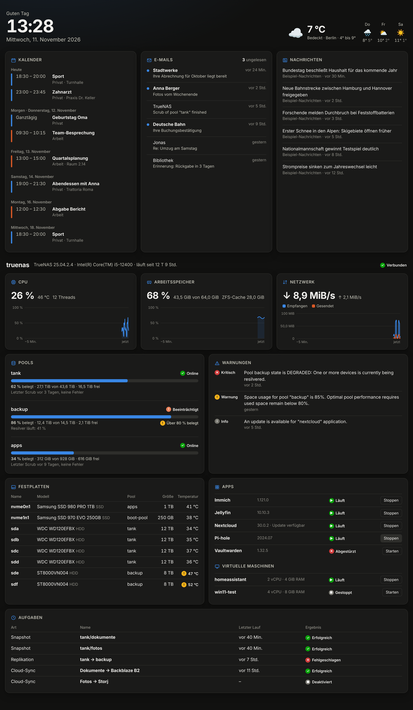

# TrueNAS-Dashboard

Persönliches Dashboard für TrueNAS: Systemlast, Pools, Festplatten, Apps, VMs,
Warnungen und Aufgaben – dazu optional E-Mails, Kalender, Nachrichten und Wetter.



## Installation in einem Schritt

Du brauchst nur die IP-Adresse deines TrueNAS und einen API-Key. Den Key erzeugst
du in der TrueNAS-Oberfläche: oben rechts auf das Benutzersymbol → *API Keys*
(je nach Version *My API Keys*) → *Add*. Den Key sofort kopieren.

Dann in TrueNAS unter *System → Shell* in einen Ordner auf deinem Pool wechseln
(z. B. `cd /mnt/tank`) und diese eine Zeile ausführen:

```bash
curl -L https://github.com/Noi922/dashboard/archive/refs/heads/main.tar.gz | tar xz && cd dashboard-main && ./setup.sh
```

Das Skript fragt nach Adresse, API-Key und einem Passwort für das Dashboard und
startet danach alles. Das Dashboard läuft dann unter `http://<IP-deines-NAS>:8080`.

Lieber von Hand herunterladen?
[ZIP-Datei herunterladen](https://github.com/Noi922/dashboard/archive/refs/heads/main.zip),
entpacken, auf das NAS kopieren und dort `./setup.sh` ausführen.

### Aktualisieren

Im Ordner über `dashboard-main` dieselbe Zeile erneut ausführen. Deine `.env`
mit den Einstellungen bleibt erhalten.

### E-Mails, Kalender, Nachrichten und Wetter einschalten

Die Datei `.env` im Ordner öffnen, die gewünschten Zeilen ausfüllen (alles ist
dort erklärt) und danach neu starten:

```bash
docker compose up -d
```

## Vorschau ohne Einrichtung

```bash
npm install
```

```bash
npm run demo
```

Danach http://localhost:8080 öffnen. Die Demo zeigt simulierte Daten.

## Manuelle Einrichtung

1. **API-Key in TrueNAS erzeugen:** in der TrueNAS-Oberfläche oben rechts auf das
   Benutzersymbol → *API Keys* (je nach Version unter *My API Keys* bzw.
   *Credentials → Users → API Keys*) → *Add*. Den Key sofort kopieren.
2. `.env.example` nach `.env` kopieren und ausfüllen. Nur `TRUENAS_HOST` und
   `TRUENAS_API_KEY` sind Pflicht; alle anderen Bereiche erscheinen erst, wenn
   sie ausgefüllt sind.
3. Starten:

```bash
docker compose up -d --build
```

Das Dashboard läuft dann auf `http://<rechner>:8080`.

### Direkt auf TrueNAS betreiben

Den Ordner auf ein Dataset kopieren, dort per Shell `docker compose up -d --build`
ausführen – oder das Image bauen und unter *Apps → Discover → Custom App* mit den
Variablen aus `.env` eintragen.

## Hinweise

- **TrueNAS-Version:** ab 25.04 wird die WebSocket-API verwendet (mit Live-Diagrammen).
  Bei älteren Versionen weicht das Dashboard automatisch auf die REST-API aus;
  Live-Diagramme und Start/Stopp gibt es dort nicht.
- **API-Key und HTTPS:** Die Verbindung zu TrueNAS läuft immer verschlüsselt.
  TrueNAS sperrt API-Keys, die unverschlüsselt übertragen wurden.
- **Sicherheit:** Der API-Key und das E-Mail-Passwort bleiben im Container und
  gelangen nie in den Browser. Setze `DASHBOARD_PASSWORD`, sobald E-Mails oder
  Termine angezeigt werden, und gib das Dashboard nicht ins Internet frei.
- **E-Mail:** Der Zugriff ist rein lesend, es wird nichts als gelesen markiert.
  Bei web.de und GMX muss IMAP in den Postfach-Einstellungen erst aktiviert werden.
- **Kalender:** Google, Nextcloud, iCloud und Outlook bieten jeweils einen
  „geheimen“ bzw. öffentlichen iCal-Link in den Kalender-Einstellungen an.
